I am an MSc student in Computer Science at the University of Calgary.

I work on AI safety at the intersection of human–AI interaction and visualization. 
I study how people understand, question, and decide when to rely on AI systems, 
with a focus on making AI behavior and uncertainty easier to understand and evaluate.

<i>Orbit</i> is a data visualization of my GitHub activity that I designed and built. Every day since I joined GitHub is a character on the spiral, denser on busier days, and each public repository is a moon that orbits faster the more I work on it. It redraws itself every morning (<a href="https://github.com/falahsheikh/ascii-orbit">source</a>).

[hello@falahsheikh.com](mailto:hello@falahsheikh.com)
